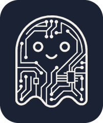
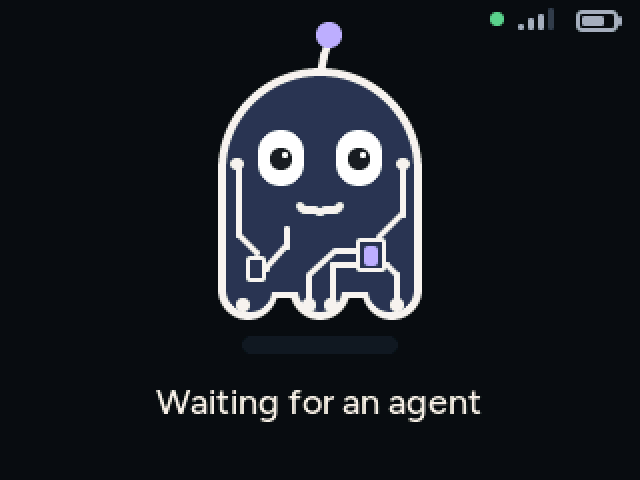
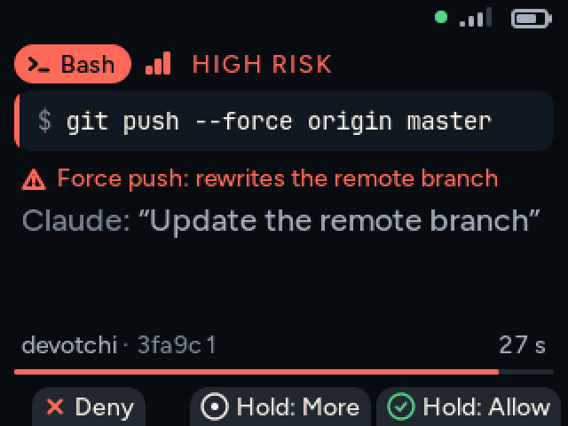
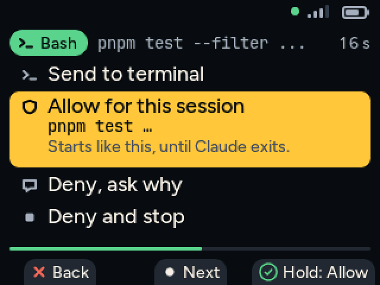
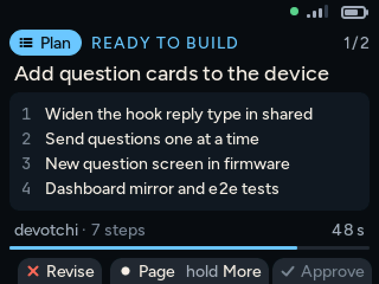
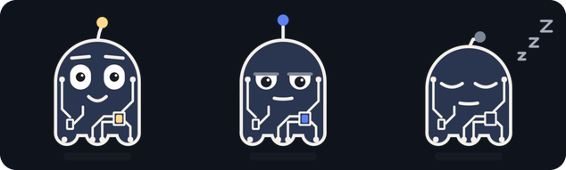

<p align="center">
  
</p>

<h1 align="center">Devotchi</h1>

<p align="center">
  <b>A desk pet for your coding agent.</b><br>
  See what Claude Code is doing and answer it with three buttons.
</p>

<p align="center">
  
  
</p>

When Claude Code needs you, Devotchi buzzes and shows the request. You allow,
deny or answer from across the desk. Between requests, its pet shows how the
work is going.

> Devotchi never decides on its own. Only a button press allows or denies.
> If nobody answers, Claude Code's normal terminal prompt takes over.

## Features

- **Approvals.** See the exact command and its risk. Allow, deny, allow for this
  session, or send it to the terminal. High-risk commands need a hold.
- **Questions and plans.** Answer Claude's questions and approve or revise its plans.
- **A pet with moods.** 11 moods and 5 reactions, driven by Claude Code hooks.
- **Clock face** while idle, **Showcase mode** for demos, real **sleep modes**
  and battery support.
- **Self-hosted.** A small server on your PC, a local dashboard, optional
  multi-user hosting.

## Screens

<table>
  <tr>
    <td align="center"><br><sub>Decision menu</sub></td>
    <td align="center"><br><sub>Question from Claude</sub></td>
    <td align="center"><br><sub>Plan approval</sub></td>
  </tr>
  <tr>
    <td align="center"><br><sub>Tests passed</sub></td>
    <td align="center"><br><sub>Clock face</sub></td>
    <td align="center"><br><sub>Settings</sub></td>
  </tr>
</table>

Screenshots are taken from the real device. The full design is in [docs/design](docs/design/index.html).

## Pets

Each pet is one JSON file in [`pets/`](pets/README.md). Adding a pet needs no code.

| | |
|---|---|
|  | **Devo** (default)<br>The Devotchi ghost. Its circuits light up while it works, and it dozes off when you're away. |
|  | **Mochi**<br>A squishy little block that wears its mood in its colour. |
|  | **Ember**<br>A tiny dragon. Fumes smoke when it's angry and breathes fire when it's excited. |
|  | **Sprout**<br>An egg with a leaf that droops on bad days. Add it from the dashboard. |

Shown in the happy, focused and sleeping moods.

## How it works

```
Claude Code ──hooks──▶ Devotchi server ──Wi-Fi──▶ Devotchi device
  (your PC)            (Node, SQLite)              (ESP32-S3 + LCD)
                            │
                            └──▶ dashboard (browser)
```

1. `devotchi setup` adds HTTP hooks to Claude Code.
2. Requests go to the server, which shows them on the device and the dashboard.
3. You press a button. The device sends a heartbeat while it shows a request,
   so the server knows it is alive.
4. If nobody answers in time (default 30 s), or no device is online, Claude
   Code shows its own prompt.

## Quick start

Needs Node 22.13+ and pnpm 10.

```bash
pnpm install && pnpm run build
alias devotchi="node $PWD/packages/client/dist/cli.js"

devotchi start --local --lan   # server on :8080, dashboard on 127.0.0.1:3456
devotchi setup                 # add the hooks to this project
```

Then set up the device:

1. **Wi-Fi:** install the **ESP BLE Provisioning** app and scan the QR code
   *inside the app*. Your phone's camera app can't do this.
2. **Server:** the device connects to `ws://<your PC>:8080`. Change it with
   `server ws://<ip>:8080` on the USB console.
3. **Pair:** run `devotchi pair <CODE>` with the code on the screen.

For a hosted server with TLS and accounts, see [docs/deploy.md](docs/deploy.md).

## Buttons

| | Left | Middle | Right |
|---|---|---|---|
| **Home** | Poke | Recent activity · hold: menu | Pat |
| **Request** | Deny | Hold: more options | Allow (high risk: hold) |
| **Settings** | Up · hold: back | Next | Open |

Any press wakes the device and does nothing else.

## CLI

```bash
devotchi start | setup | pair <CODE> | status | doctor
devotchi devices | pets | mode [ask|desk] | hold [seconds]
devotchi notify <event> | run -- <cmd> | sim | mcp | login | config
```

Run `devotchi doctor` when something doesn't work. Full list: [CLAUDE.md](CLAUDE.md#client-cli).

## Hardware


- ESP32-S3-MINI-1 (Wi-Fi, BLE, 4 MB flash, 2 MB PSRAM)
- 2.0" 320x240 IPS display (ST7789)
- 3 buttons, vibration motor, status LED
- LiPo battery with USB-C charging

Details: [hardware/README.md](hardware/README.md).

<br clear="right">

## Development

```bash
pnpm test && pnpm run typecheck && pnpm run lint
```

The firmware is plain C on ESP-IDF 6.0 with LVGL 9. Building, flashing and
tests: [firmware/README.md](firmware/README.md).

| Folder | What's in it |
|---|---|
| `firmware/` | ESP32-S3 firmware and host tests |
| `packages/` | `shared` protocol, `server`, `client` (CLI, MCP, dashboard) |
| `pets/` | Pet JSON files |
| `docs/` | [Architecture](docs/architecture.md), [protocol](docs/protocol.md), [design](docs/design/index.html) |
| `hardware/`, `case/` | PCB and enclosure |

Open work: [TODO.md](TODO.md).

## License

[MIT](LICENSE)
