<p align="center">
  
</p>

<h1 align="center">Devotchi</h1>

<p align="center">
  <b>Your coding agent's desk pet.</b><br>
  A small ESP32 device that shows what Claude Code is doing and lets you answer it with three buttons.
</p>

<p align="center">
  
  
</p>

---

No more staring at a terminal waiting for a permission prompt. When Claude Code
needs you, Devotchi buzzes, shows the exact command and lets you allow or deny
it from across the desk. Between requests its pet mirrors the work: focused
while editing, happy when tests pass, asleep when the session hits its usage
limit.

Devotchi **never decides on its own**. Only a button press allows or denies.
Anything else (nobody answered, no device online, desk mode) falls back to
Claude Code's own terminal prompt.

## Features

- **Permission requests on the device.** The exact command first, its risk and
  why, and Claude's own description. High-risk commands need a 1.2 s hold.
- **A decision menu.** Allow once, allow for this session (one narrow rule,
  shown word for word), deny and ask why, deny and stop, or send to terminal.
- **Questions and plans.** Pick answers to Claude's questions (single and multi
  select) and approve, revise or stop plans, on the device or the dashboard.
- **A pet with moods.** Eleven moods and five reactions driven by Claude Code
  hooks and the MCP tools. Pets are data: one JSON file each, no code.
- **A clock face** with a sleeping pet when nothing is going on, and a dark
  night look.
- **Showcase mode** to demo it to friends: moods, reactions and sample cards
  that never send a real decision.
- **Real power management.** Dim, screen off, clock, light sleep and deep sleep;
  any button wakes it. Battery level, charging and low-battery protection.
- **Self-hosted.** A small Node server on your PC or LAN, a local dashboard, and
  optional multi-user hosting with TLS.

## A look at the device

All screenshots are taken from the real device over its USB console.

<table>
  <tr>
    <td align="center"><br><sub>Decision menu</sub></td>
    <td align="center">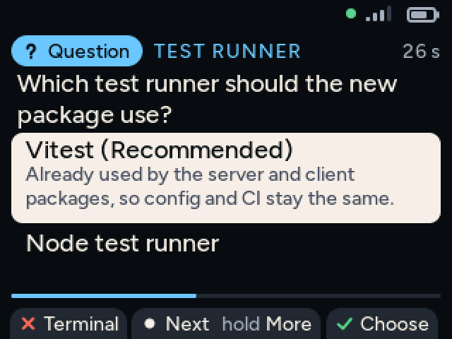<br><sub>A question from Claude</sub></td>
    <td align="center"><br><sub>Plan approval</sub></td>
  </tr>
  <tr>
    <td align="center">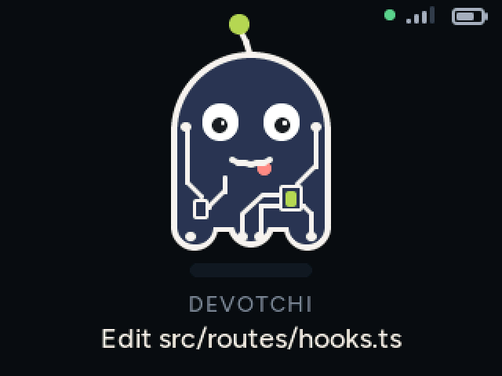<br><sub>Working on a file</sub></td>
    <td align="center">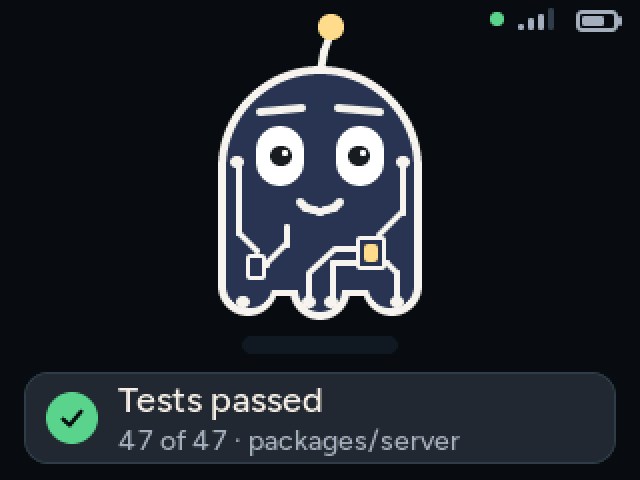<br><sub>Tests passed</sub></td>
    <td align="center">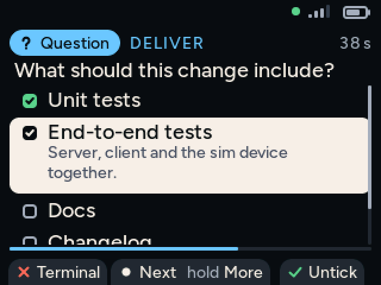<br><sub>Multi-select answers</sub></td>
  </tr>
  <tr>
    <td align="center">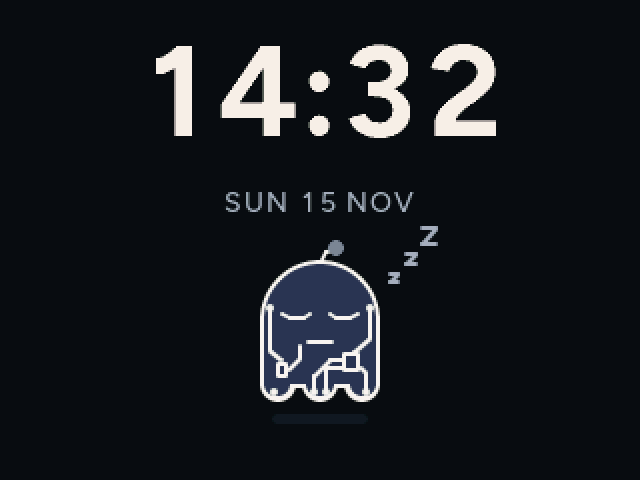<br><sub>Clock face</sub></td>
    <td align="center">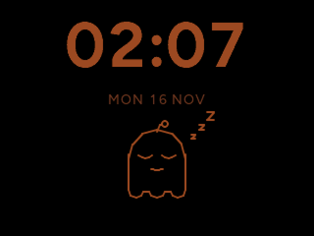<br><sub>Clock at night</sub></td>
    <td align="center">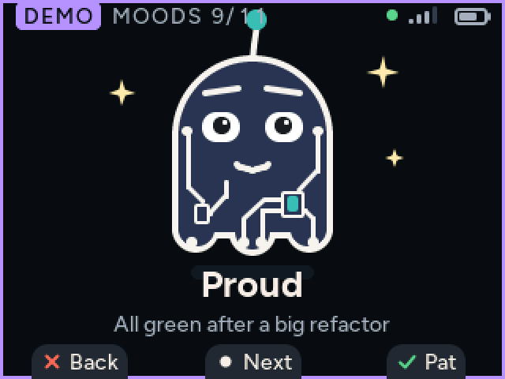<br><sub>Showcase mode</sub></td>
  </tr>
  <tr>
    <td align="center">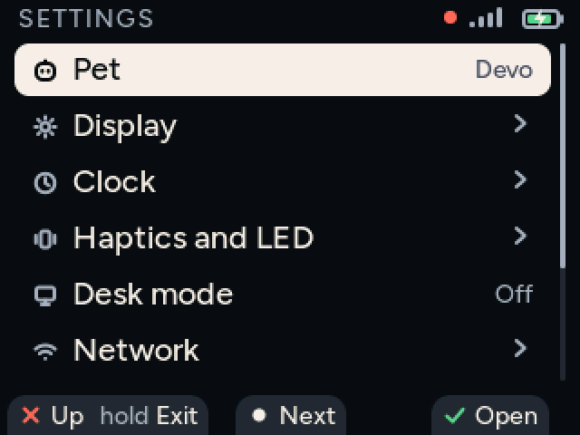<br><sub>Settings</sub></td>
    <td align="center">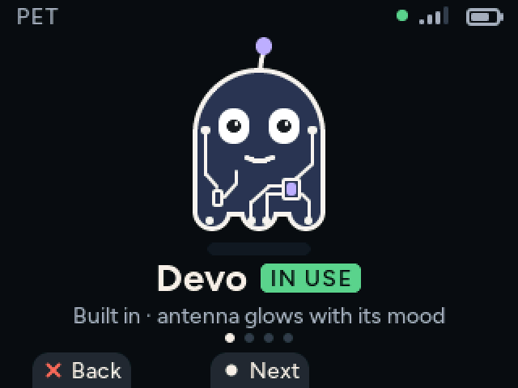<br><sub>Pet picker</sub></td>
    <td align="center">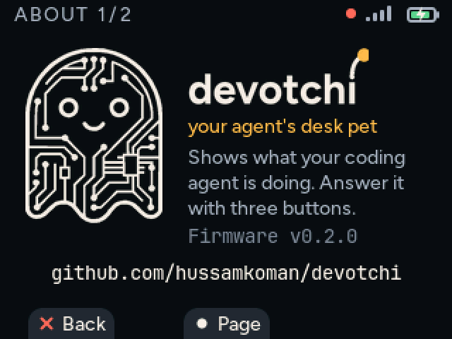<br><sub>About</sub></td>
  </tr>
</table>

The full design (64 screens, design system, UX flows, pet animations) is in
[docs/design](docs/design/index.html).

## How it works

```
+------------------+          +---------------------+
|  Your PC         |  hooks   |  Devotchi server    |
|  Claude Code  ---|--------->|  /hook/event        |
|                  |          |  WebSocket rooms    |
|  MCP server   ---|--ws----->|  SQLite             |
|  dashboard    <--|--ws------|                     |
+------------------+          +---------+-----------+
                                        | WebSocket (Wi-Fi)
                                        v
                              +---------------------+
                              |  Devotchi device    |
                              |  (ESP32-S3 + LCD)   |
                              +---------------------+
```

1. `devotchi setup` installs nine **Claude Code HTTP hooks** in your project.
2. A permission request, question or plan goes to the **server**, which shows it
   on every device and on the local dashboard.
3. You answer with a **button**. The device acknowledges at once and sends a
   heartbeat every 4 s while it shows the request, so the server always knows
   it is alive.
4. The other hooks send status lines, cancel requests the terminal already
   handled, and put the pet to rest on a usage limit.
5. The optional **MCP server** lets the agent set the status text and mood and
   send notifications.

### When nobody answers

The hook returns the neutral reply and Claude Code shows its own terminal prompt:

- after the **hold time** (default 30 s, 10 s to 5 min: `devotchi hold <s>`);
- at once when no device is online, a device does not acknowledge within 3 s,
  or its heartbeat stops;
- at once in **desk mode** (`devotchi mode desk`), for when you are at the keyboard;
- when you press **send to terminal**.

## Quick start

You need Node 22.13 or newer and pnpm 10.

```bash
pnpm install && pnpm run build
alias devotchi="node $PWD/packages/client/dist/cli.js"

devotchi start --local --lan     # server on :8080 + dashboard on http://127.0.0.1:3456
devotchi setup                   # install the Claude Code hooks for this project
claude mcp add devotchi -- devotchi mcp   # optional: status, mood and notify tools
```

### Set up the device

1. **Wi-Fi.** On first start the device shows a QR code. Install Espressif's
   **ESP BLE Provisioning** app (Android, iOS), scan the code *inside the app*
   and pick your network. The phone's camera app cannot do this. No camera?
   The middle button shows the device name and a code to type in instead.
2. **Server.** The device connects to `ws://<your PC>:8080`. Change it from the
   USB console with `server ws://<ip>:8080`.
3. **Pairing.** The device shows a code:

   ```bash
   devotchi pair <CODE>          # or type it into the dashboard
   devotchi status               # device online, battery, last request
   ```

For a server on the internet with TLS and accounts, see [docs/deploy.md](docs/deploy.md).

### The buttons

| | Left (reject) | Middle (action) | Right (approve) |
|---|---|---|---|
| **Home** | Poke the pet | Recent activity; hold: quick menu | Pat the pet |
| **Request card** | Deny | Hold: more options | Allow (high risk: hold 1.2 s) |
| **Settings** | Up; hold: back or exit | Next | Open / change |

Any button wakes the device; that press does nothing else.

## Pets

Pets are data. Each one is a single [`pets/<id>.pet.json`](pets/README.md):
palette, body parts, face, and how it moves in each mood. The firmware draws it
with one shared rig, and the server, dashboard and simulator read the same file.

- **Devo**, the default: the ghost from the PCB silkscreen, with a dark body,
  white outline and white circuit traces. Its antenna ball and chip light show
  the mood colour.
- **Mochi**, a soft square with an antenna, and **Ember**, a small dragon, are
  also built in.
- **Sprout**, an egg with a leaf, lives in the catalog. `devotchi pets send <id>`
  or the dashboard installs it into one of the device's 8 slots.

Adding a pet needs no code: copy `pets/_template.pet.json`, preview it with
`pnpm run pet-sheet <id> --png`, check it with `firmware/tools/petpack.py check`,
and list it in `pets/builtin.txt` to compile it in.

## CLI

| Command | What it does |
|---|---|
| `devotchi start [--local [--lan]] [--server <url>]` | Dashboard on 127.0.0.1:3456; `--local` runs the server in the same process |
| `devotchi setup [--dir D] [--check \| --remove]` | Install, check or remove the nine Claude Code hooks |
| `devotchi pair <CODE>` / `pair --new` | Confirm a device's code / create one for the device console |
| `devotchi devices [list \| rename \| identify \| rm]` | Paired devices with online state, battery and pet |
| `devotchi pets [list \| add \| rm \| send \| use]` | Pet gallery, uploads and installing pets on a device |
| `devotchi status [--json]` / `doctor` | Server, devices and last request / read-only checks of the whole setup |
| `devotchi mode [ask \| desk]` / `hold [s]` | Send requests to devices or the terminal / how long a request waits |
| `devotchi notify <event> [detail]` / `run -- <cmd>` | Notify from a script / run a command and notify its result |
| `devotchi sim` | Headless virtual device for testing |
| `devotchi mcp` | MCP server on stdio |
| `devotchi login` / `logout` | Accounts on a multi-user server |
| `devotchi config [get \| set \| path]` | Show or change the configuration |

The default server is `http://localhost:8080`; every command takes
`--server <url>`. When something does not work, run `devotchi doctor` first.

## Hardware

First prototype PCB, designed in KiCad and made by JLCPCB.

<p align="center">
  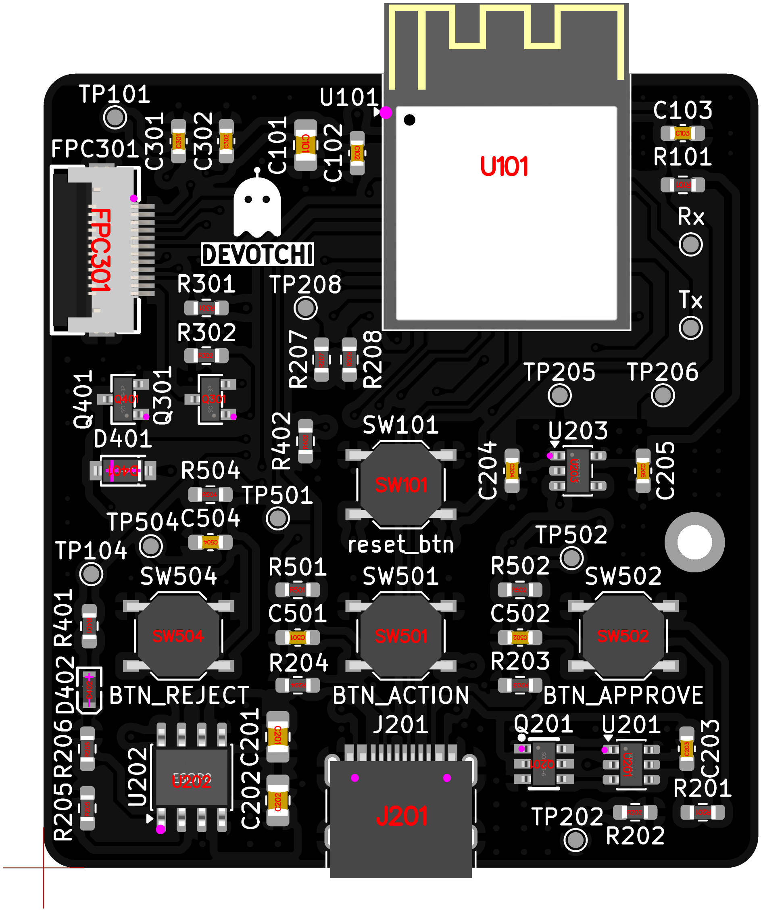
</p>

- **MCU:** ESP32-S3-MINI-1 (dual-core 240 MHz, Wi-Fi + BLE, 4 MB flash, 2 MB PSRAM)
- **Display:** 2.0" IPS TFT, 320x240, ST7789 over SPI
- **Input:** three buttons (reject, action, approve); any press wakes it from deep sleep
- **Power:** LiPo battery, USB-C charging (TP4056), DW01A protection, ME6211 3.3 V LDO
- **Output:** status LED and vibration motor

Details, pin assignments and BOM: [hardware/README.md](hardware/README.md).

## Project status

Working prototype. The firmware (plain C on ESP-IDF 6.0 with LVGL 9), server,
CLI, MCP server, hooks and dashboard are complete for single-user use on a LAN.
Multi-user mode and the Docker/Caddy deployment are written and tested locally.
Hardware checks with a battery fitted and the next case revision are open; see
[TODO.md](TODO.md).

## Repository

```
firmware/          ESP32-S3 firmware (C, ESP-IDF 6.0, LVGL 9), host tests and board tools
packages/
  shared/          Protocol v2 types and validators, pet pack codec and SVG renderer
  server/          Koa WebSocket server, REST API, SQLite
  client/          CLI, MCP server, web dashboard
pets/              One JSON file per pet, golden packs, built-in list
docs/              Architecture, protocol, deployment, device design
hardware/          KiCad schematics, PCB layout, BOM
case/              3D-printable enclosure exploration
```

## Development

```bash
pnpm install          # Node >= 22.13, pnpm 10
pnpm run build
pnpm test             # all package tests (vitest)
pnpm run typecheck
pnpm run lint
pnpm run dev          # dashboard with HMR against `devotchi start --dev`
pnpm run pet-sheet    # pet preview sheets
```

Firmware: see [firmware/README.md](firmware/README.md) for building, flashing,
the USB console and the board tests. The host tests need no ESP-IDF:

```bash
cmake -S firmware/host_test -B build-host -DDEVOTCHI_HOST_TEST_FETCH=ON
cmake --build build-host && ctest --test-dir build-host
```

## Documentation

- [Architecture](docs/architecture.md): system overview, layers, data flow
- [Protocol](docs/protocol.md): the wire protocol between server, devices and dashboard
- [Deployment](docs/deploy.md): LAN self-hosting, Docker Compose with Caddy, multi-user mode, backups
- [Device design](docs/design/index.html): design system, UX flows, pet animations, mockups
- [Firmware](firmware/README.md) and [conventions](firmware/CONVENTIONS.md)
- [Pets](pets/README.md): the pet format and how to add one
- [Manual tests](docs/phase2-manual-tests.md): checks on a real Claude Code session
- [Hardware](hardware/README.md)

## License

[MIT](LICENSE)
